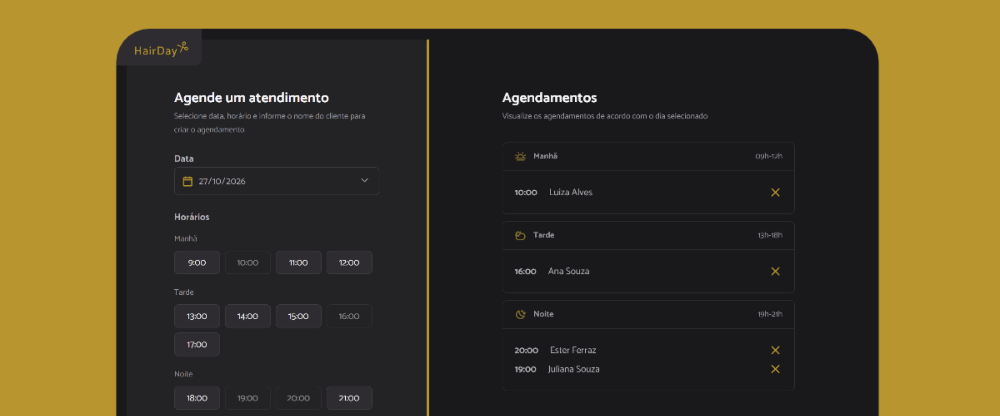

Projeto desenvolvido em ambiente de estudos como exemplo
para um site de agendamento de cortes de cabelo.

Neste projeto consegui aprender mais sobre NPM, WebpackServer
e integrações e configurações de APIs.

Utilizando
- JavaScript
- NPM
- JSON server
- Webpack Bundler
- API hospedada em Render (Deploy)